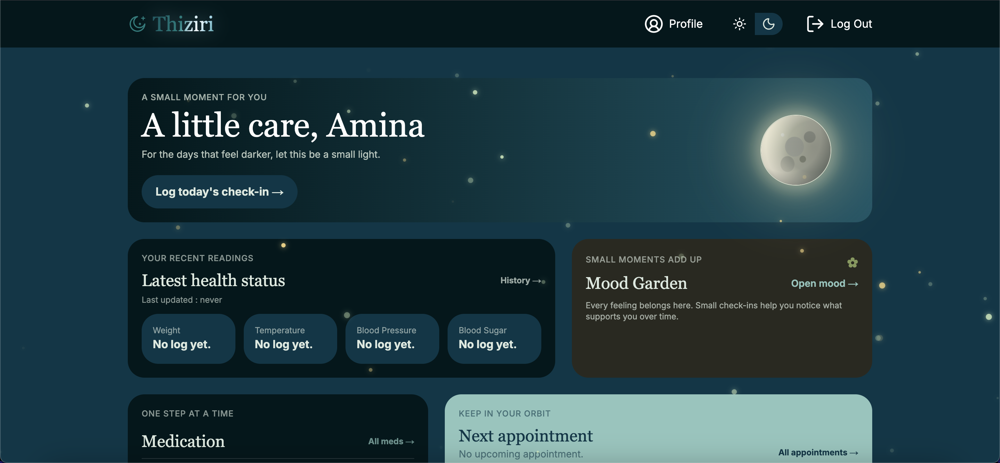
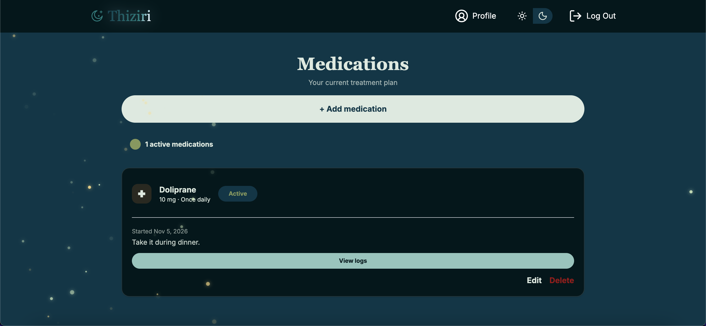
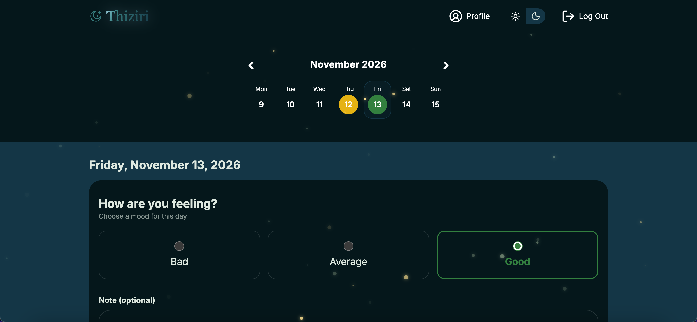
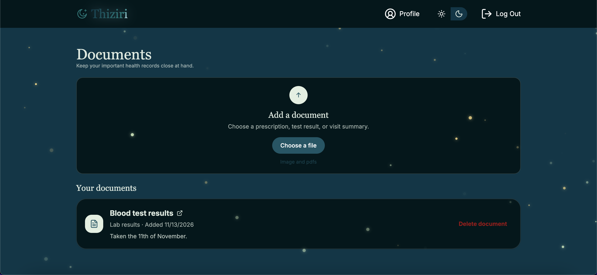

# Thiziri 🌙

**Thiziri** (meaning _moonlight_ in Kabyle) is a full-stack personal health management application designed to help users organize and keep track of their health information in one place.

From daily health and mood tracking to medication management, medical appointments, and document storage, Thiziri provides a centralized space for managing personal health records through an intuitive dashboard.

<p align="center">
  <a href="amina-thiziri.vercel.app">🌐 Live Demo</a>
</p>

## 📸 Screenshots

<!-- Replace the placeholders with screenshots of your application -->

| Dashboard                               | Medication Management                       |
| --------------------------------------- | ------------------------------------------- |
|  |  |

| Mood Tracking                                   | Document Management                     |
| ----------------------------------------------- | --------------------------------------- |
|  |  |

## ✨ Features

- **Authentication** — Secure sign-up and login with email/password credentials and Google OAuth.
- **Health Profile** — Manage personal health information, chronic conditions, and allergies.
- **Daily Health Tracking** — Record and monitor daily health status.
- **Mood Tracking** — Log daily moods and visualize mood history.
- **Medication Management** — Manage medications and track dosage history through medication logs.
- **Appointment Management** — Keep track of upcoming and past medical appointments.
- **Medical Document Uploads** — Upload and manage personal medical documents using UploadThing.
- **Emergency Contacts** — Store important emergency contact information.
- **Dashboard** — Access and manage health information from a centralized interface.

## 🛠️ Tech Stack

| Category       | Technologies          |
| -------------- | --------------------- |
| Framework      | Next.js (App Router)  |
| Language       | TypeScript            |
| Frontend       | React, Tailwind CSS   |
| Database       | PostgreSQL            |
| ORM            | Prisma                |
| Authentication | Auth.js, Google OAuth |
| File Storage   | UploadThing           |

## 🗄️ Database Architecture

Thiziri uses PostgreSQL with Prisma ORM to manage its relational data model.

The application includes the following models:

- `User` — User accounts and authentication.
- `Account` — OAuth account associations.
- `HealthProfile` — Personal health information.
- `HealthStatus` — Daily health records.
- `MoodEntry` — Mood tracking entries.
- `Medication` — Medication information.
- `MedicationLog` — Medication dosage history.
- `Appointment` — Medical appointments.
- `Allergy` — Recorded allergies.
- `ChronicIllness` — Chronic health conditions.
- `Document` — Uploaded medical documents.
- `EmergencyContact` — Emergency contact information.

## 🚀 Getting Started

### Prerequisites

- Node.js
- PostgreSQL database
- npm

### Installation

1. Clone the repository:

   ```bash
   git clone YOUR_GITHUB_REPOSITORY_URL
   cd thiziri
   ```

2. Install dependencies:

   ```bash
   npm install
   ```

3. Create a `.env` file in the project root and configure the required environment variables:

   ```env
   DATABASE_URL=
   AUTH_SECRET=
   UPLOADTHING_TOKEN=
   AUTH_GOOGLE_ID=
   AUTH_GOOGLE_SECRET=
   ```

4. Generate the Prisma client and apply database migrations:

   ```bash
   npx prisma generate
   npx prisma migrate dev
   ```

5. Start the development server:

   ```bash
   npm run dev
   ```

6. Open [http://localhost:3000](http://localhost:3000) in your browser.

### Environment Variables

| Variable             | Description                                                     |
| -------------------- | --------------------------------------------------------------- |
| `DATABASE_URL`       | PostgreSQL database connection string.                          |
| `AUTH_SECRET`        | Secret used by Auth.js for authentication and session security. |
| `UPLOADTHING_TOKEN`  | UploadThing token for document uploads.                         |
| `AUTH_GOOGLE_ID`     | Google OAuth client ID.                                         |
| `AUTH_GOOGLE_SECRET` | Google OAuth client secret.                                     |

**Note:** Never commit your `.env` file or expose your secret values publicly.

## 💡 Motivation

Thiziri was built as a full-stack portfolio project to deepen my experience with modern web development, relational database design, authentication, file uploads, and building complete application workflows.

The name _Thiziri_ means "moonlight" in Kabyle. Choosing a name from my language was a deliberate way to bring a piece of my culture into a project I've built from the ground up.

---

**Built by [Amina Assouane](https://github.com/AminaAssouane)**
